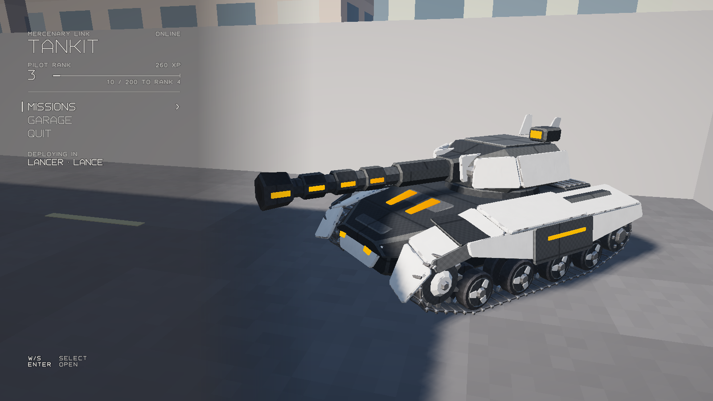
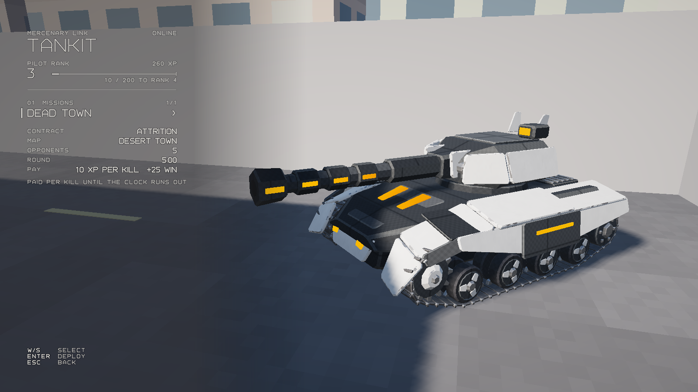
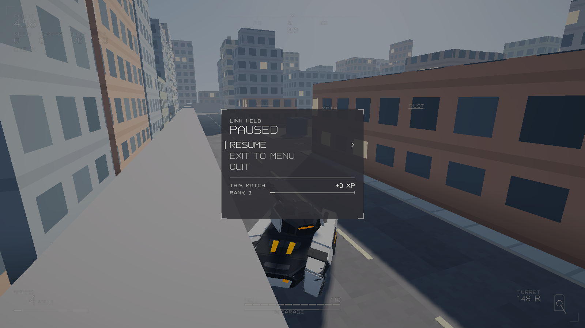

# tankit

Single-player arcade tank arena shooter: fast tanks, dense procedurally
generated city maps, bots, and an XP + crystals progression loop.

Look: rugged, solid metal, exposed machinery — see [docs/design-direction.md](docs/design-direction.md).

Plain Rust: `winit` + `wgpu`, no engine.

## Run

```sh
cargo run --release                          # main menu: missions, garage, pilot rank
cargo run --release -- --bots 7              # skip the menu: straight into a round (random map), more opponents (0-7)
cargo run --release -- --seed 21             # play a specific map
cargo run --release -- --map proving         # physics test course (jumps, ramps, bumps, stairs, hills)
cargo run --release -- --seed 21 --shot out.png --time 5 --size 1600x900   # headless frame to PNG
cargo run --release -- --hull bastion --turret maul   # start with a different loadout
cargo run --release -- --seed 21 --garage --hull bastion --time 2 --shot garage.png   # garage open, Bastion picked
cargo run --release -- --screen menu --xp 260 --time 2 --shot menu.png   # main menu (also: missions, pause)
cargo run --release -- --showroom            # every hull x turret combo, animated, orbiting camera
cargo run --release -- --showroom --focus 0 --dist 8 --orbit 120 --time 3 --shot tank.png
cargo run --release -- --map proving --spawn 2 --straight --time 1.2 --frames 90 --shot clip/f.png   # frame sequence
cargo test
```

## Controls

Tanki-style: the camera rides behind the turret, and the turret is turned with keys.

| Key | Action |
|---|---|
| W/S or ↑/↓ | throttle / reverse |
| A/D or ←/→ | turn hull |
| Z / X | rotate turret left / right (it turns with the hull) |
| C | swing turret back to center |
| PageUp / PageDown | camera height |
| Space | fire (hold to keep firing as the gun reloads) |
| Tab | scoreboard |
| G | garage: park, orbit the tank, swap hull and turret (see below) |
| Enter | play the round again (once the clock runs out) |
| 1 / 2 | quick-cycle the hull / turret queued for the next respawn |
| R | restart the round at the next spawn point (cycles the proving ground lanes) |
| F5 | new random map |
| [ / ] | live tuning: sideways grip ×0.9 / ×1.1 |
| ; / ' | live tuning: turn rate −/+ 0.1 rad/s |
| Backspace | reset live tuning |
| Esc | pause (resume / exit to menu / quit); back to the menu once the round is over |

## Game loop

`cargo run` opens the **main menu**, over the first mission's map with your
tank parked in it:

- **Missions**: pick one and deploy. A mission is a map plus a contract
  (game mode). For now there's one: *Dead Town*, an Attrition contract
  (deathmatch, 5 bots) on the desert town (fixed seed 21).
- **Garage**: the same garage panel as in battle. Both answer one question:
  what tank you spawn in next. From the menu that's the tank you deploy in.
- **Quit**.

In a match, **Esc** pauses (the battle freezes): resume, exit to menu, or
quit. When the round ends, Enter plays it again and Esc goes back to the menu.

**XP and pilot rank.** Every enemy you kill pays 10 XP the moment it dies
(a `+10 XP` pops over the crosshair), and finishing the round on top pays
25 more. Leaving early keeps everything earned so far. Rank comes from total
XP: 100 to reach rank 2, then 50 more per rank (150, 200, ...). Rank will
gate parts later; for now it's tracked and shown.

**Saving** is automatic. One pilot profile (XP and the kit you deploy in)
lives at `~/.local/share/tankit/profile.json` (the OS data directory
elsewhere) and is rewritten whenever it changes. Delete it to start over.





Any match flag (`--seed`, `--map`, `--spawn`, `--bots`, `--hull`, `--turret`)
skips the menu and drops straight into a round, for testing.

Code: `src/menu.rs` (main menu, mission select, pause), `src/mission.rs`,
`src/profile.rs`, XP in `src/combat.rs`, the state machine in `src/app.rs`.

## Garage

Press **G** mid-battle (alive or waiting to respawn), or pick **Garage** in the main menu. The tank parks where
it is (and stays a target), the HUD fades out and the camera swings round
to orbit it, with a panel listing the hulls and turrets and their stats.
What you pick is fitted **at your next respawn**; the orbit camera shows it
on your tank as a preview, and the HUD shows `NEXT SPAWN` until then.
Respawning or the round ending closes the garage.

| Key | Action |
|---|---|
| W/S or ↑/↓ | previous / next part |
| A/D or ←/→ | switch between hull and turret |
| Enter or G | back to battle with this pick queued |
| Esc | cancel: keep what was queued before |

Stat bars are scaled to the best part in the kit; a faint tick marks the
part you're driving now.


## Deathmatch

Five-minute rounds, every tank for itself, most kills wins (ties go to fewer
deaths). Tank 0 is you; the rest are bots with randomly picked kits.

- **Guns** (`src/combat.rs`): shells are real projectiles (160 m/s, gravity)
  swept against the physics world each step. Lance hits for 38 every 1.4 s;
  Maul for 15 every 0.5 s. Lancer hulls have 110 HP, Bastion 160.
  A hit shoves the target; a kill pops the wreck and it smokes until respawn.
- **Vertical auto-aim:** a tank roughly along your gun line (within ~5°) gets
  the elevation, so hills and ramps don't eat every shot.
- **Respawn** after 4 s at the open spot farthest from the living, with 2 s of
  spawn shield (no damage, bots ignore you).
- **Bots** (`src/ai.rs`): A* over a 2 m nav grid built from the map's solids,
  string-pulled into straight runs. Each bot hunts the nearest enemy
  (preferring ones in sight), drives the path, jinks back and forth at close
  range, backs out when stuck, leads its shots a little with a per-shot aim
  error, and waits a short reaction time before opening fire. They drive with
  the same `Command` as the player: no physics shortcuts.

## Tank kit

Tanks are procedural (`src/tank/`), assembled from beveled armor plates and
chamfered lofted solids, so they read as built from panels. Two hulls
(Lancer: light wedge; Bastion: heavy, segmented skirts) and two turrets
(Lance: long rail cannon; Maul: twin short cannons) mix freely. Light plates
take the team color; dark composite, metal and the orange light strips don't.

Animated: separate tread links running around the wheels at each side's own
speed (so a pivot turn counter-rotates them), spinning road wheels and
sprockets, turret yaw, gun pitch, barrel recoil with muzzle flash (twin guns
alternate), hull pitch/roll and a little rumble, and pulsing light strips.
Surface detail (carbon weave, panel seams, edge wear) is in the shader,
materials 6–11 in `scene.wgsl`.

## Physics

Tanks are rapier3d rigid bodies with honest gravity and contacts. The
tank-specific part (`src/sim.rs`) is the track model: a spring ray per road
wheel carries the weight, and every point where a track touches the world
(road wheels, or the swept-up track run around the sprocket and idler) pushes
along the belt's direction of travel there, limited by friction times that
contact's load. Climbing, pivot turns, and skid steering all come out of that.
Road wheels and the tread belt in the art follow the suspension.

