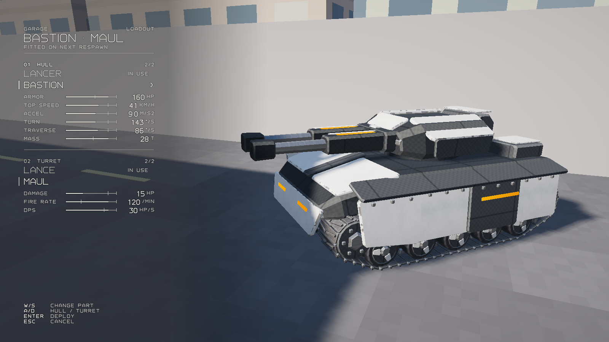
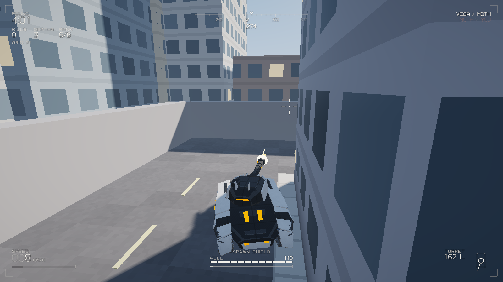
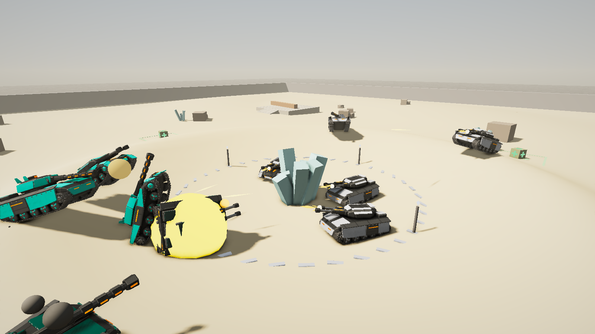

# tankit

Single-player arcade tank arena shooter: fast tanks, hand-built and
procedural maps, bots, and a faction trust + crystals progression loop.

Setting: [docs/setting.md](docs/setting.md). Look: [docs/design-direction.md](docs/design-direction.md).

Plain Rust: `winit` + `wgpu`, no engine.

This README says what each part is and where it lives. Numbers, lists and
tuning (maps, missions, damage, trust, timings) live in the code, and the code is
the reference for them.

## Run

```sh
cargo run --release              # main menu
cargo run --release -- --help    # every flag: maps, loadouts, headless screenshots, showroom
cargo test
```

Any match flag (`--map`, `--seed`, `--team-size`, ...) skips the menu and drops
straight into a round. `--shot` renders headless to a PNG instead of opening a
window, and `--screen` does the same for a menu screen.

## Controls

Tanki-style: the camera rides behind the turret, and the turret is turned with keys.

| Key | Action |
|---|---|
| W/S or ↑/↓ | throttle / reverse |
| A/D or ←/→ | turn hull |
| Z / X | rotate turret left / right (it turns with the hull) |
| C | swing turret back to center |
| Space | fire (hold to keep firing) |
| PageUp / PageDown | camera height |
| Tab | scoreboard |
| G | garage |
| 1 / 2 | quick-cycle the hull / turret for the next respawn |
| Esc | pause; back to the menu once the round is over |
| Enter | play again once the round is over |

Menus and the garage list their own keys on screen.

Dev keys: R restarts at the next spawn point, F5 rolls a new random city, and
`[ ]`, `; '` and Backspace adjust live tuning (grip, turn rate) and reset it.
The window title shows the current tuning.

## How it fits together

| Part | What it is | Code |
|---|---|---|
| Game loop | Main menu → mission → match → pause or round over → back to the menu. | `src/app.rs` |
| Menus | Main menu, mission select and pause, drawn in the hairline style. | `src/menu.rs` |
| Missions | Dead Town is Attrition on Saltmarket, Crystal Vein is Hold on Shard Flats, Kept Fire is Attrition for the Ithessar on the Kiln. Either of a map's two sides can hire you (A/D on the mission screen). `--contract` and `--employer` pick them outside the menu. | `src/mission.rs` |
| Pilot profile | Trust with each faction (and the standing it adds up to), crystals, owned parts and their upgrades, and the kit you deploy in. Autosaved as JSON in the OS data directory (`~/.local/share/tankit/` on Linux); delete it to start over. | `src/profile.rs` |
| Deathmatch | Timed rounds, every tank for itself. Covers the weapons (shells, bouncing plasma, the overheating beam, flame), kills, trust with your employer (paid on the kill), respawns with spawn shield, and vertical auto-aim. | `src/combat.rs` |
| Hold | King of the hill, side against side: secure the crystal deposit. Only your side in the ring banks time for it; both sides in it contest it. First side to the target wins, otherwise the side with the most time held when the clock runs out. Each tank's own time on the site orders the scoreboard and pays the HOLD line. Bots make for the site and fight whoever comes near it. | `src/hold.rs` |
| Repair drops | Crates parachute onto fixed drop zones on a timer and mend part of a damaged tank's hull. | `src/repair.rs` |
| Garage | Pick the hull and turret you spawn in next, and buy or upgrade parts, from the menu or mid-battle. Each turret shows its maker faction. | `src/garage.rs` |
| Crystals | What a finished contract pays (completion, placement, contribution, kill bounty), part prices and the standing with their maker they're sold at (hulls: with anyone), and upgrade levels with their cost and stat bonus. | `src/economy.rs` |
| Bots | A* over a nav grid built from the map, driving with the same `Command` as the player (no physics shortcuts). | `src/ai.rs` |
| Maps | Procedural cities, the proving ground (a physics test course) and hand-built maps: Saltmarket, Shard Flats (a placeholder: open flats around a crystal deposit), and the Kiln (a stub: Ithessar monoliths holding a plasma core). | `src/map.rs`, `src/map/` |
| Tank kit | Procedural hulls and turrets that mix freely, built from beveled plates, with tread links, wheels, recoil and suspension all animated. Surface detail is in the shader. The Ithessar kit is its own: knapped crystal, a hover hull (Sethuun) with gimballing emitters, and turrets that charge an orb between claws (Ammeth) or spin up crystal needles (Ossrin). | `src/tank/`, `src/tank/ithessar.rs`, `src/shaders/scene.wgsl` |
| Physics | rapier3d rigid bodies plus a track model: spring rays per road wheel carry the weight, and every track contact pushes along the belt, limited by friction times load. Climbing, pivot turns and skid steering all come out of that. The hover hull swaps the tracks for six plasma springs: thrust, braking and sideways grip all push through the cushion, so it's fast, drifts through turns and glides over low ledges. | `src/sim.rs` |
| HUD | Hairline readouts, kill feed, name tags, trust popups and the scoreboard. | `src/hud.rs`, `src/ui/` |

## Screenshots

`docs/screenshots/` holds renders from `--shot`.





